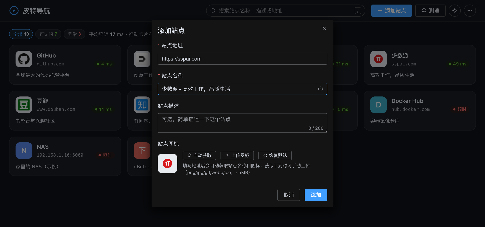
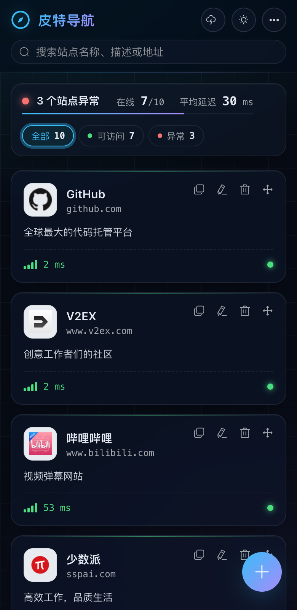

# 皮特导航

[](https://github.com/manone2077/Navigator/actions/workflows/docker-image.yml)
[](https://hub.docker.com/r/greatpower/navigator)
[](https://github.com/manone2077/Navigator/tags)

轻量的自托管站点导航，适合在 NAS / 家庭服务器上管理内网服务和常用网站。


| 添加站点 | 移动端 |
| --- | --- |
|  |  |

## 功能

- 自动获取站点名称和图标（支持自签名证书、非根路径图标），也可手动上传
- 测速并提示失败原因，后台每 10 分钟自动测速，点击延迟标签可单独重测
- 拖拽排序、搜索（`/` 聚焦）、按状态筛选
- 导出 / 导入备份（包含图标）
- 可选访问密码与访客只读模式
- 深色模式、移动端适配，支持 `amd64` / `arm64`

## 部署

```yaml
services:
  navigator:
    image: greatpower/navigator:latest
    container_name: MyNavigator
    restart: always
    ports:
      - "9000:80"
    volumes:
      - /your/path/config:/app/data
    # environment:
    #   - NAV_PASSWORD=你的密码    # 启用访问密码
    #   - NAV_GUEST_VIEW=true      # 未登录也可只读浏览
```

或使用命令：`docker run -d --name MyNavigator --restart always -p 9000:80 -v /your/path/config:/app/data greatpower/navigator:latest`

| 环境变量 | 说明 |
| --- | --- |
| `NAV_PASSWORD` | 访问密码，未设置时无需登录 |
| `NAV_GUEST_VIEW` | 为 `true` 时未登录用户可只读浏览，默认 `false` |
| `JAVA_OPTS` | JVM 参数，默认 `-XX:+UseSerialGC -Xss512k -Xms32m -Xmx192m` |
| `TZ` | 时区，默认 `Asia/Shanghai` |

数据保存在 `/app/data`（`db/` 为数据库，`public/images/` 为图标），升级时拉取新镜像并重建容器即可，数据会自动迁移。建议升级前先在「…」菜单中导出备份。

## 常见问题

- **图标显示为文字头像**：站点没有图标或容器无法访问该站点。可在编辑时点击「自动获取」，或手动上传。
- **显示「不可达 / 超时」但浏览器能打开**：测速由容器发起，悬停延迟标签可查看原因，请确认容器网络能访问该地址。
- **忘记密码**：修改 `NAV_PASSWORD` 后重建容器即可。

## 开发

前端项目：[Navigator_front](https://github.com/manone2077/Navigator_front)（Vue 3 + Element Plus），后端为 Spring Boot 3 + H2，镜像内由 nginx 提供页面并代理 `/api`。

- 本地构建：两个项目放在同一目录，前端执行 `yarn build`（输出到本项目 `docker/dist`），再执行 `./mvnw package && docker build .`（国内可加 `--build-arg APK_MIRROR=https://mirrors.aliyun.com`）
- 测试：`./mvnw test`
- 发布：在 `release/vX.Y.Z` 分支执行 `git push --atomic origin release/vX.Y.Z vX.Y.Z`，GitHub Actions 会构建前端、运行测试并推送镜像 `vX.Y.Z` 与 `latest`；前端有改动时先给前端打同名标签。发布后将 release 分支合并回 `master` 和 `dev`。

## Todo

- [ ] 分类
- [ ] 直接添加 PT 站点
- [ ] 支持代理访问
- [x] 单个删除、备份、访问密码、Docker 自动部署
