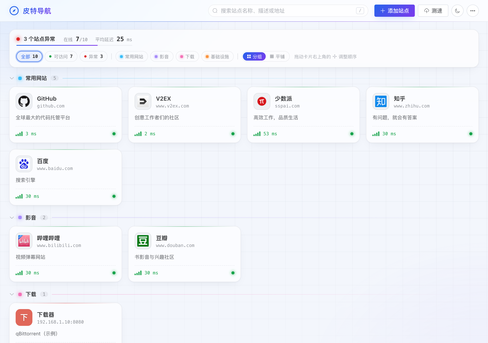

<p align="center">
  
</p>

<h1 align="center">皮特导航</h1>

<p align="center">轻量的自托管站点导航，适合在 NAS / 家庭服务器上管理内网服务和常用网站</p>

<p align="center">
  <a href="https://github.com/manone2077/Navigator/actions/workflows/docker-image.yml"></a>
  <a href="https://hub.docker.com/r/greatpower/navigator"></a>
  <a href="https://github.com/manone2077/Navigator/tags"></a>
</p>


| 浅色模式 | 添加站点 | 移动端 |
| --- | --- | --- |
|  |  |  |

## 功能

**整理站点**
- 标签分组：一个站点可以有多个标签，自动按标签分组显示，分组可折叠
- 添加站点时选择已有标签，或输入名称直接新建；在「…」→「管理标签」中预定义标签、改名、改颜色、拖动调整分组顺序
- 拖拽排序、搜索（按 `/` 聚焦）、按状态或标签筛选，可切换分组 / 平铺视图

**添加更省事**
- 填写地址后自动获取站点名称和图标（支持自签名证书、非根路径图标），也可手动上传
- 只输入 `192.168.1.2:8080` 时自动补全为 `http://`，`443 / 8443 / 9443 / 8006` 端口和公网域名补全为 `https://`

**状态一目了然**
- 测速显示信号格和延迟，后台每 10 分钟自动测速，点击延迟可单独重测
- 不可达时提示原因：连接被拒绝 / 无法路由到主机 / 域名无法解析 / 超时
- 状态面板显示整体状态、在线比例和平均延迟

**安全与数据**
- 可选访问密码，并可开放访客只读浏览
- 导出 / 导入 JSON 备份，包含图标和标签，可迁移到其它实例

**其它**
- 深色 / 浅色模式（默认跟随系统），移动端适配
- 镜像支持 `amd64` / `arm64`，内置健康检查

## 部署

**Docker Compose / Portainer Stack**

```yaml
services:
  navigator:
    image: greatpower/navigator:latest
    container_name: MyNavigator
    restart: always
    ports:
      - "9000:80"
    volumes:
      - /your/path/config:/app/data
    # environment:
    #   - NAV_PASSWORD=你的密码    # 启用访问密码
    #   - NAV_GUEST_VIEW=true      # 未登录也可只读浏览
```

**Docker 命令**

```shell
docker run -d --name MyNavigator --restart always -p 9000:80 \
  -v /your/path/config:/app/data greatpower/navigator:latest
```

启动后访问 `http://你的IP:9000/`。

| 环境变量 | 说明 |
| --- | --- |
| `NAV_PASSWORD` | 访问密码，未设置时无需登录 |
| `NAV_GUEST_VIEW` | 为 `true` 时未登录用户可只读浏览，默认 `false` |
| `JAVA_OPTS` | JVM 参数，默认 `-XX:+UseSerialGC -Xss512k -Xms32m -Xmx192m` |
| `TZ` | 时区，默认 `Asia/Shanghai` |

数据都保存在 `/app/data`（`db/` 为数据库，`public/images/` 为图标），备份或迁移时复制整个目录即可。

## 升级

拉取新镜像并重建容器即可，数据会自动升级（每次发布前都会自动测试从上一版本升级）。建议升级前先在「…」菜单中导出备份。

- **Portainer**：容器页面点击 **Recreate** 并勾选 **Re-pull image**，或在 Stack 中 **Update the stack** 并勾选 **Re-pull image**
- **Docker**：`docker pull greatpower/navigator:latest`，然后删除并用相同的数据目录重新创建容器

## 常见问题

- **图标显示为文字头像**：站点没有图标或容器无法访问该站点。编辑站点时点击「自动获取」，或手动上传；「…」→「重新获取图标」可批量重试。
- **显示「不可达 / 超时」但浏览器能打开**：测速由容器发起，悬停在延迟上可查看原因，请确认容器网络能访问该地址（不同网段、防火墙等）。
- **同一个站点出现在多个分组**：站点有多个标签时会在每个对应分组中显示；不想这样可以切换到「平铺」视图。
- **删除标签会删除站点吗**：不会，只会移除该标签；没有标签的站点显示在「未分组」。
- **忘记密码**：修改 `NAV_PASSWORD` 后重建容器即可。
- **用脚本调用接口**：读取接口为 GET（如 `/api/all`、`/api/tags`）；修改类接口只接受 POST，并需要带请求头 `X-Requested-With: XMLHttpRequest`（防止跨站请求伪造），设置了密码时还需先登录。

## 开发

```
Navigator/
├── frontend/   前端（Vue 3 + Element Plus），原 Navigator_front 仓库已合并到这里
├── src/        后端（Spring Boot 3 + H2）
├── docker/     nginx 配置、启动脚本、镜像冒烟测试
└── Dockerfile  一次构建前端 + 后端 + 精简 JRE
```

镜像内由 nginx 提供页面和图标，并把 `/api` 转发给后端。

- 本地开发：后端 `./mvnw spring-boot:run -Dspring-boot.run.profiles=dev`；前端 `cd frontend && yarn && yarn dev`（`/api` 代理到 8000 端口）
- 构建镜像：`docker build -t navigator .`（国内可加 `--build-arg APK_MIRROR=https://mirrors.aliyun.com`）
- 测试：`./mvnw test`；镜像冒烟测试（含模拟从旧版本升级）：`docker/smoke-test.sh navigator greatpower/navigator:latest`
- CI：推送任意分支或提交 PR 都会构建前端并运行后端测试；推送 `release/vX.Y.Z` 分支或 `vX.Y.Z` 标签时，冒烟测试通过后才会推送镜像 `vX.Y.Z` 与 `latest`
- 发布：在 `release/vX.Y.Z` 分支执行 `git push --atomic origin release/vX.Y.Z vX.Y.Z`，发布后将 release 分支合并回 `master` 和 `dev`

## Todo

- [ ] 直接添加 PT 站点
- [ ] 支持代理访问
- [x] 标签分组
- [x] 单个删除、备份导入导出、访问密码、Docker 自动部署
