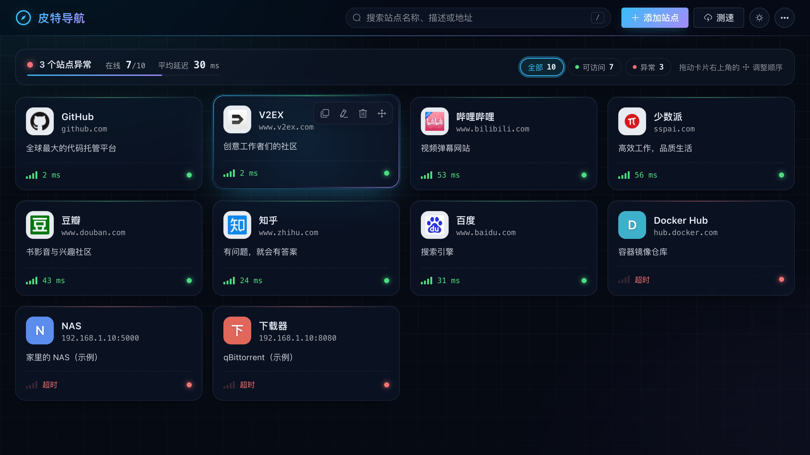

# 皮特导航

Navigator for website management

## 功能

- 站点卡片展示：自动获取 favicon（失败时显示文字头像，也可上传自定义图标）
- 添加 / 编辑 / 单个删除 / 删除全部站点
- 拖拽排序（排序会保存到服务端）
- 搜索过滤（按 `/` 快速聚焦搜索框，只有一个结果时回车直接打开）
- 测速：通过 TCP 连接站点端口测量延迟，后台每 10 分钟自动测速一次
- 备份：导出 / 导入 JSON 备份文件
- 深色模式（默认跟随系统）、移动端适配
- 镜像同时支持 `linux/amd64` 与 `linux/arm64`

## Todo

1. 分类
2. 直接添加PT 站点
3. 支持代理访问[in progress]
4. 支持单个删除[√]
5. 备份（导入、导出）[√]
6. docker 自动部署[√]

## Docker 部署
```shell
docker run -d -p 9000:80 --name MyNavigator -v /config:/app/data greatpower/navigator:latest
```

## 开发相关
0. 前端项目为 [Navigator_front](https://github.com/manone2077/Navigator_front)，将两个项目放在同一目录下，在前端项目中执行 `yarn build` 会把产物输出到本项目的 `docker/dist`，随后提交即可参与镜像构建
1. 本项目使用git 进行版本管理
2. 主要分为`master、dev、release` 三个分支，
   1. [dev](https://github.com/manone2077/Navigator/tree/dev) 在 dev 分支上创建功能(` git checkout -b feature/your-feature-name`)分支进行开发。
   2. [release](https://github.com/manone2077/Navigator/tree/release) 从 dev 分支创建一个 release 分支,通过 release 分支进行最后的测试和准备发布(调整需要使用的配置文件等)。
   3. [master](https://github.com/manone2077/Navigator) 用作部署(只用来合并`release` 分支代码)
   4. 推送 `release/vX.Y.Z` 分支或 `vX.Y.Z` 标签会触发 GitHub Actions 构建并推送镜像 `navigator:vX.Y.Z` 与 `navigator:latest`
   5. 最后，将 release 分支合并回 dev 分支，以确保 dev 分支包含最新的稳定代码`如果只是修改了release 需要使用的配置，则可以不合并`

## 效果如下
访问  http://yourip:9000/   
图像获取失败，不是系统问题，是本身对应的站点没有favicon 文件导致，可以忽略或点击图片位置上传一张即可
